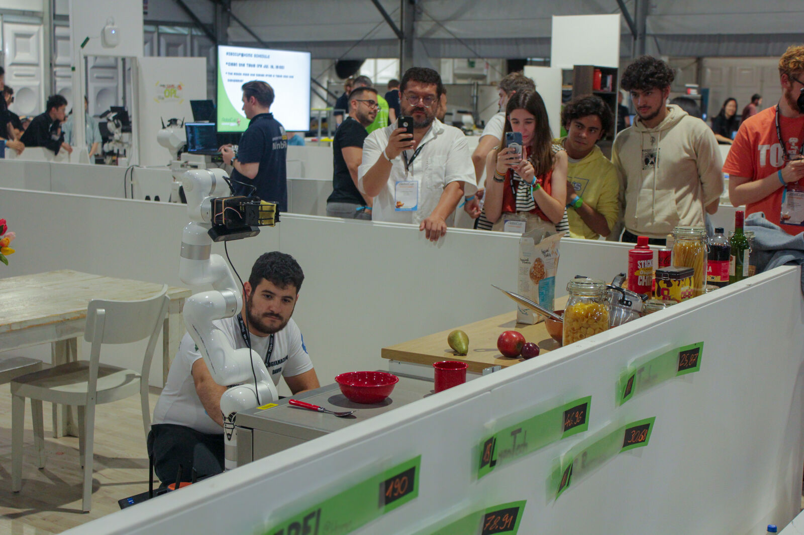
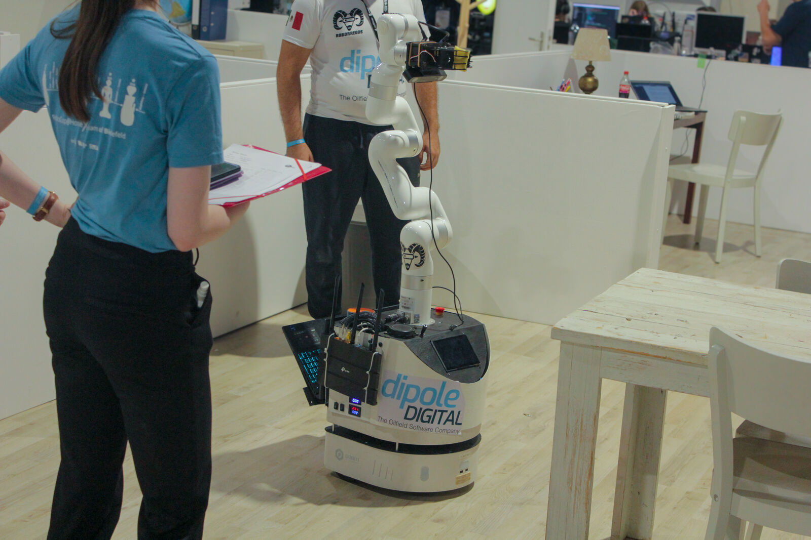
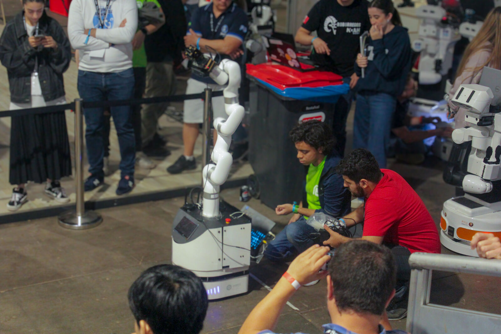

# Media

Throughout the years, the Robocup@Home team at RoBorregos has had the opportunity to participate in various events and competitions. Here are some of the highlights of our journey.

## Press

- *Desarrollan estudiantes del Tec su "robotina"*, [El Norte](https://www.elnorte.com/desarrollan-estudiantes-del-tec-su-robotina/ar3218970).
- El Norte, printed edition, section Vida, July 23, 2026: [page scan](https://www.elnorte.com/edicionimpresa/aplicacionEI/webview/compartir/ImagenEdImpresa.aspx?Titulo=Vida&Resumen=23+de+julio&img=https://hemerotecalibre.elnorte.com/20260723/large/NVID20260723-004.JPG&md5=caa5e4c3b1ef30694a54de9a512a0490).

## Photos

### RoboCup 2024, Eindhoven

## Videos

### RoboCup@Home 2026 Qualification video

<iframe width="560" height="315" src="https://www.youtube.com/embed/qUQNTDRBEKw" title="RoboCup@Home Video 2026" frameborder="0" allowfullscreen></iframe>

### RoboCup@Home 2025 Qualification video

<iframe width="560" height="315" src="https://www.youtube.com/embed/bxXwOzza02E" title="RoboCup@Home Video 2025" frameborder="0" allowfullscreen></iframe>

### RoboCup@Home 2024 Qualification video

<iframe width="560" height="315" src="https://www.youtube.com/embed/g9W2A_bHTvg" title="RoboCup@Home Video 2024" frameborder="0" allowfullscreen></iframe>

### Compilation of Demos, competitions, and events

<iframe width="560" height="315" src="https://www.youtube.com/embed/M9okZ_EFCcE" title="RoboCup@Home Evolution" frameborder="0" allowfullscreen></iframe>

### Conexión Tec 2021

<iframe width="560" height="315" src="https://www.youtube.com/embed/sBfiKc-LmK8" title="RoboCup@Home: Service robot for the home" frameborder="0" allowfullscreen></iframe>
